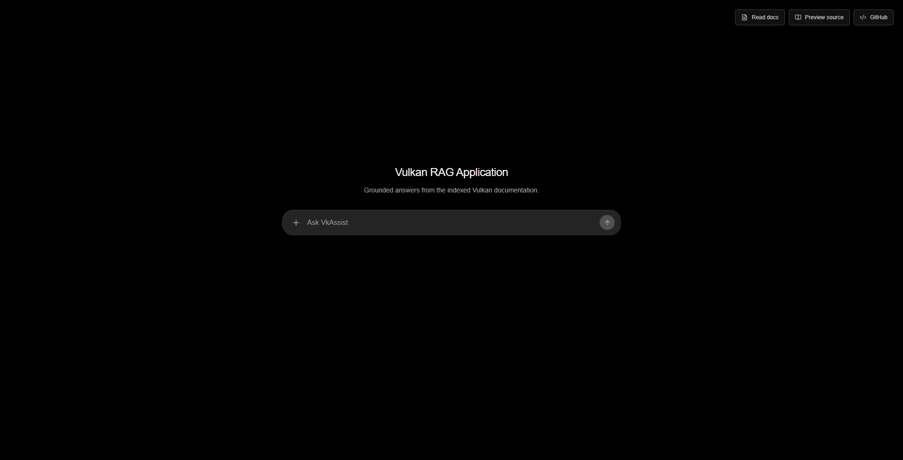
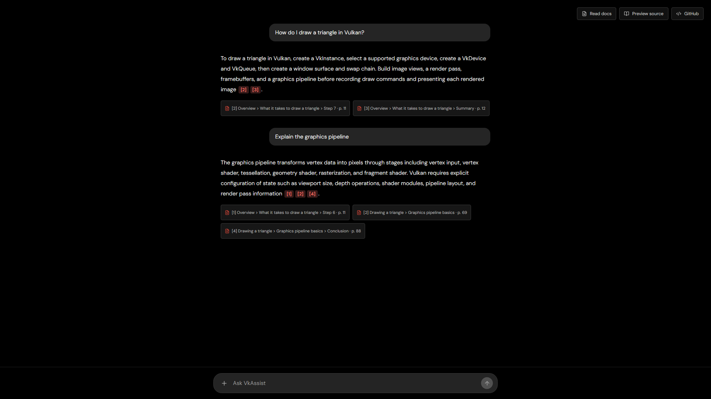
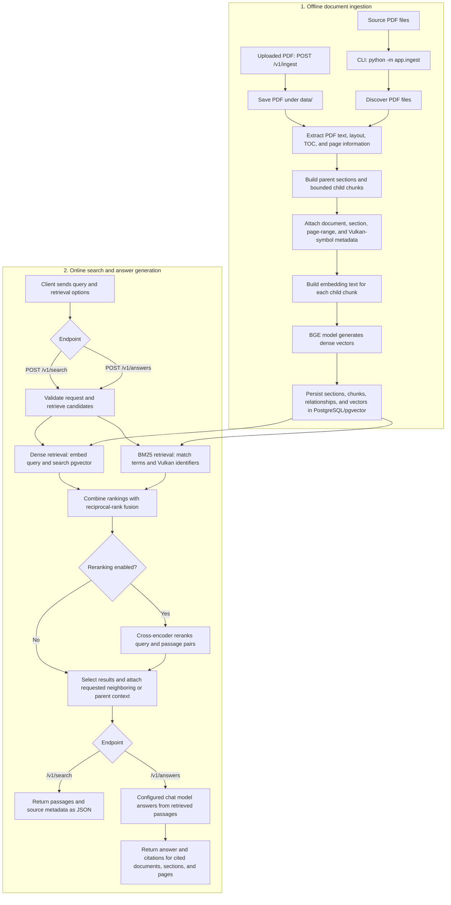

# vkassist

`vkassist` is a production-minded RAG backend for Vulkan documentation. It ingests technical PDFs, performs hybrid retrieval, reranks evidence, expands relevant context, and can generate grounded answers with source citations through a local or hosted OpenAI-compatible model.

## Application previews

<p align="center">
  
</p>

<p align="center">
  
</p>

## Architecture

```text
PDF
  → TOC-aware layout extraction
  → parent sections + bounded child chunks
  → BGE embeddings + PostgreSQL/pgvector

Query
  → dense cosine retrieval + BM25 lexical retrieval
  → reciprocal-rank fusion
  → cross-encoder reranking
  → parent sliding-window or full-parent context
  → optional cited answer generation
```

### Retrieval design

- **Structure-aware ingestion:** PyMuPDF layout blocks, TOC hierarchy, repeated-header/footer filtering, printed-heading detection, page ranges, and Vulkan API-symbol metadata.
- **Parent-child indexing:** section parents are stored separately from child chunks. Retrieval ranks children precisely, then can return nearby siblings or the full parent section.
- **Hybrid retrieval:** normalized `BAAI/bge-base-en-v1.5` embeddings (768 dimensions) use pgvector cosine search alongside BM25 lexical retrieval; reciprocal-rank fusion combines both candidate lists.
- **Reranking:** `cross-encoder/ms-marco-MiniLM-L6-v2` scores query/chunk pairs after fusion.
- **Grounded answers:** an optional local Ollama or hosted OpenAI-compatible endpoint receives only retrieved passages and is instructed to cite them.

## How the RAG pipeline works

The application has two phases: **ingest PDF documents into the knowledge base**, then **retrieve relevant evidence for each query**. PostgreSQL with pgvector stores the document sections, searchable child chunks, and dense vectors used at query time.

### Ingestion

1. **Choose PDF sources.** Run `python -m app.ingest` with a PDF path, several PDF paths, or a directory. For example, `python -m app.ingest data\ --replace` discovers the PDFs under `data\`.
2. **Extract and structure content.** PyMuPDF reads text and layout, using table-of-contents and detected headings to organize content into parent sections and bounded child chunks. The parser retains page ranges and Vulkan API-symbol metadata.
3. **Prepare embedding text.** Each child chunk is combined with relevant source metadata, such as its document name, section, page number, and API symbols.
4. **Generate and save vectors.** The BGE embedding model encodes the chunk text. The application saves each chunk, its vector, and its parent-section relationship in PostgreSQL/pgvector.
5. **Update documents safely.** `--replace` replaces indexed sections and chunks for the PDF files passed to that command. It leaves other indexed documents untouched; `--replace-all` clears the entire index before ingesting the selected PDFs.

Ingestion runs as a command-line task and needs to complete before those documents can be retrieved. The same parsing and indexing pipeline is also used by `POST /v1/ingest` for PDF uploads.

### Query and answer

1. **Accept a search request.** `POST /v1/search` and `POST /v1/answers` accept a query and options such as result limit, document filter, reranking, and context size.
2. **Retrieve candidates in parallel paths.** Dense retrieval embeds the query and finds nearby vectors in pgvector. BM25 tokenizes the query and indexed chunk text, preserving Vulkan identifiers such as `vkQueueSubmit`, `VK_*` constants, and VUIDs.
3. **Fuse and optionally rerank.** Reciprocal-rank fusion combines the two candidate rankings. When reranking is enabled, the cross-encoder scores each query/candidate passage pair and reorders the results by relevance.
4. **Add context and source metadata.** The service can attach neighboring chunks or the full parent section, and returns document names, section paths, source pages, API symbols, and retrieval scores.
5. **Return evidence or generate an answer.** `/v1/search` returns the passages directly. `/v1/answers` passes the retrieved passages to the configured OpenAI-compatible chat model, which must answer from that evidence and cite its sources. Answer generation requires `LLM_BASE_URL` and `LLM_MODEL`; retrieval itself does not.

The API initializes the database and loads the embedding and reranking models on startup. On first use, model files may need to be downloaded. A successful `/health` response confirms the API can connect to PostgreSQL; ingest the PDFs separately to populate a new or empty database.

### RAG data flow



## Project layout

```text
app/
  api/          FastAPI endpoints, health, and metrics
  cli/          Search and benchmark commands
  core/         Settings, PostgreSQL engine, and ORM models
  evaluations/  Retrieval metrics and report generation
  indexing/     Embedding-text construction
  ingestion/    PDF parsing and document ingestion
  retrieval/    Dense, BM25, fusion, and reranking stages
  services/     Grounded answer-generation service
  tests/        Unit tests
data/evaluation/  Versioned relevance judgments and reports
```

## Quick start

```powershell
python -m venv .venv
.\.venv\Scripts\Activate.ps1
pip install -r requirements.txt
Copy-Item .env.example .env
docker compose up -d postgres

# Ingest a single PDF, multiple PDFs, or an entire directory of PDFs:
python -m app.ingest data\vulkan_documentation.pdf --replace
python -m app.ingest data\ --replace
```

Run hybrid retrieval and cross-encoder reranking across all documents or a specific document:

```powershell
# Search across all indexed documents
python -m app.search "What does vkCmdPipelineBarrier do?" --rerank --limit 5

# Search inside a specific document
python -m app.search "What does vkCmdPipelineBarrier do?" --document "vulkan_documentation.pdf" --rerank --limit 5
```

Use adjacent child context (the default is one chunk on either side):

```powershell
python -m app.search "Explain the graphics pipeline" --rerank --context-window 2
```

Return a child’s complete parent section when broad context is required:

```powershell
python -m app.search "Explain swap chain recreation" --rerank --parent-context --context-window 0
```

## API

Start the HTTP service locally:

```powershell
uvicorn app.api.main:app --host 127.0.0.1 --port 8000
```

### Test from Postman, Talend API Tester, or Insomnia

No interactive `/docs` page is required. Create a request with these settings:

| Field | Value |
| --- | --- |
| Method | `POST` |
| URL | `http://127.0.0.1:8000/v1/search` |
| Header | `Content-Type: application/json` |
| Body | Raw JSON |

Use this JSON body to inspect retrieved passages:

```json
{
  "query": "What does vkCmdPipelineBarrier do?",
  "limit": 3,
  "rerank": true,
  "context_window": 1,
  "parent_context": false
}
```

The service also exposes `GET /health`, `GET /metrics`, `POST /v1/answers`, `GET /v1/documents` (lists all indexed documents and stats), `POST /v1/ingest` (upload new PDF), `DELETE /v1/documents/{document_name}`, and `GET /v1/documents/{document_name}`.

### Local Ollama answers

The answer endpoint uses an OpenAI-compatible chat-completions interface. With Ollama running locally:

```env
LLM_BASE_URL=http://localhost:11434/v1
LLM_MODEL=qwen3:4b
LLM_API_KEY=ollama
LLM_TIMEOUT_SECONDS=120
LLM_MAX_TOKENS=600
```

Create another `POST` request in your API client:

| Field | Value |
| --- | --- |
| URL | `http://127.0.0.1:8000/v1/answers` |
| Header | `Content-Type: application/json` |
| Body | Raw JSON |

```json
{
  "query": "What is a swapchain?",
  "limit": 5,
  "rerank": true,
  "context_window": 1,
  "parent_context": false
}
```

The response contains an `answer` string and a `citations` array with the document name, section, and source page for every citation used.

For Docker deployment, run `docker compose up --build`. Use `host.docker.internal` instead of `localhost` in `LLM_BASE_URL` when Ollama runs on the Windows host.

## Evaluation

The versioned benchmark has 72 page-labeled Vulkan queries: 36 tutorial queries judged against `vulkan_documentation.pdf` and 36 specification queries judged against `vkspec.pdf`. Relevance requires both the expected document and a matching page, so a coincidentally matching page number from another PDF is not counted. It records Recall@k, MRR@k, nDCG@k, per-query retrieved documents/pages, and P50/P95 latency.

```powershell
python -m app.evaluate --output data\evaluation\reports\hybrid-reranked.json
python -m app.evaluate --no-rerank --output data\evaluation\reports\hybrid-only.json
```

These commands evaluate global retrieval across the indexed corpus while scoring only evidence from each case's labeled source document. To measure the document-filtered baseline as well, pass `--filter-document`; this restricts each query to its labeled document. Reports made from older page-only labels should be regenerated and not compared directly with document-aware reports.

Treat these starter labels as a maintained benchmark: review labels when the source document or chunking strategy changes, add difficult/negative queries, and compare reports before claiming a retrieval improvement. Cases are split evenly between the tutorial and Vulkan specification so global search can be measured on both documents. `vulkan11-reference-guide.pdf` is not yet represented in the relevance judgments.

## Verification

```powershell
python -m unittest app.tests.test_chunker app.tests.test_evaluation
python -m compileall -q app
```

GitHub Actions runs these checks on pushes and pull requests.
